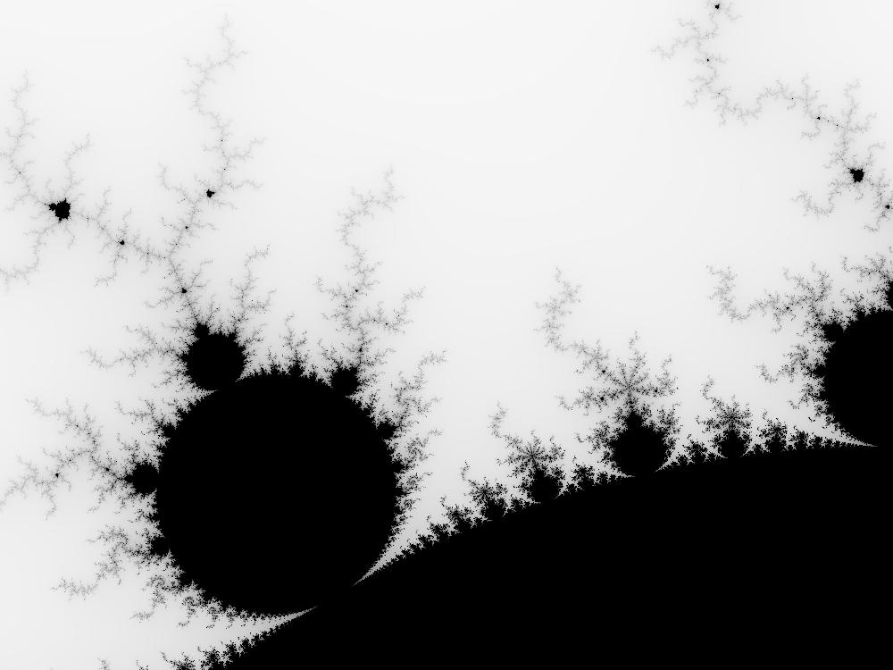

# Mandelbrot renderer — Go port

A Go implementation of the parallel Mandelbrot renderer
from "Programming Rust" (chapter on concurrency).

## Note
Небольшое исследование как Result, Option ложатся на go идиомы
val, error или val comma ok.
Также интересно было bands.into_iter().enumerate() переписать.

```console
$ go run . mandel.png 1000x750 -1.20,0.35 -1,0.20
```


